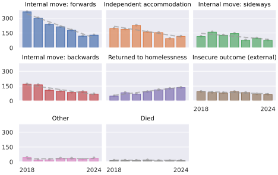
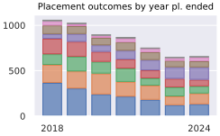
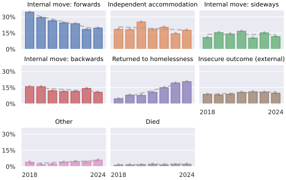
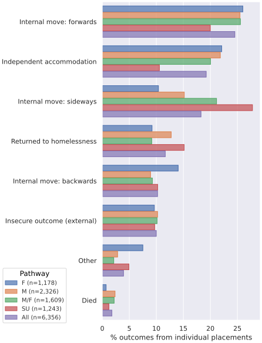

```{python}
# Setup code
import pandas as pd
from python_scripts import setup
from python_scripts import services
from python_scripts import helper
df, dffp = setup.setup(verbose=False)

from python_scripts import distinct_pathways
dpw_pls = distinct_pathways.get_distinct_pathways_routes(dffp)
qrows = dpw_pls["rt_end_cat"] == "[Not ended or invalid end reason]"
dpw_pls.loc[dpw_pls.pl_end_dt > distinct_pathways.dpw_end_dt, ["pl_end_dt", "pl_end_reason", "dur"]] = pd.NA
dpw_pls.loc[qrows, "rt_end_cat"] = dpw_pls.loc[qrows, "pl_end_dt"].isna().map({True: "[Not ended]", False: "Missing data/error"})
dpw_pls["rt_end_cat"] = dpw_pls["rt_end_cat"].str.replace("To care/hosp.", "To care/hospital")
dpw_rt_starts = dpw_pls.groupby("route_id").head(1)
dpw_rt_ends = dpw_pls.groupby("route_id").tail(1)
dpw_clis = dpw_pls.groupby(["o_cli_id"]).head(1)  # 1 duplicate client but first entry has more detailed answers

import matplotlib
import matplotlib.pyplot as plt
import seaborn.objects as so
matplotlib.rcParams.update({
    'figure.figsize': (6.2, 4.1),
    'font.size': 12,
    'figure.constrained_layout.use': True
})

asset_themes = {"opaque": "assets_output/",
                "transparent_lightbg": "assets_transparent_lightbg/",
                "transparent_darkbg": "assets_transparent_darkbg/"}
assets_output = asset_themes["opaque"]
output_dir = assets_output
transparent = False
excel_output = {}


def get_frequencies(series, sort=True, dropna=True, dropna_pct=True):
    n = series.value_counts(sort=sort, dropna=dropna).rename("n")
    pct = 100 * series.value_counts(sort=sort, dropna=(dropna or dropna_pct), normalize=True).rename("pct")
    fq_tbl = pd.concat([n, pct], axis=1)
    return fq_tbl


table_number = 0


def get_next_table_number():
    global table_number
    table_number = table_number + 1
    return table_number
```

## Outcomes from individual placements

```{python}
#| output: asis
import numpy as np
from python_scripts import routes
pl_excluded = {}
pl_end_cat_map = routes.get_end_cats_map()
pl_outcomes = dpw_pls.set_index("vac_id")
pl_outcomes["pl_end_cat"] = pl_outcomes["pl_end_reason"].map(pl_end_cat_map)
next_pls = (dpw_pls.loc[dpw_pls["prev_vac_id"].notna()]
            .rename(columns={"vac_id": "next_vac_id", "prev_vac_id": "vac_id", "svc_type_short": "pathway"})
            .set_index("vac_id"))
next_pls["pathway"] = next_pls["pathway"].cat.remove_unused_categories()
pl_outcomes.loc[next_pls.index, "pl_end_cat"] = "Internal move"
pl_outcomes.loc[dpw_pls.loc[dpw_pls["prev_svc_id"] == dpw_pls["svc_id"], "prev_vac_id"].values, "pl_end_cat"] = "Internal move: same service"
#TODO: fix duration dates for internal moves to same service
same_svc_dates = (dpw_pls.groupby(["route_id", dpw_pls["svc_id"].diff().ne(0).cumsum().fillna(0)], as_index=False)
                  .agg(vac_id=("vac_id", "last"), pl_start_dt=("pl_start_dt", "first"), pl_end_dt=("pl_end_dt", "last"))
                  .set_index("vac_id").drop(columns="route_id"))
pl_outcomes["pathway"] = pl_outcomes["svc_type_short"].cat.remove_unused_categories()
pl_outcomes["pathway_type"] = (pl_outcomes["pathway"] == "Substance Misuse Pathway").map({True: "Substance Misuse", False: "Homelessness"})
pl_outcomes["ended"] = pl_outcomes["pl_end_dt"].isna().map({True: "Current", False: "Ended"})
tbl = get_frequencies(pl_outcomes[["ended", "pathway_type", "pathway_level"]], sort=False, dropna=False)
tbl.loc[tuple(["All"] * len(tbl.index.levels)), :] = tbl.sum()
tbl = tbl.convert_dtypes()
tblno = get_next_table_number()
tbl_desc = f"Table 4.{tblno}: Placements in different pathway levels"
excel_output[tbl_desc] = tbl
print("### " + tbl_desc)
with pd.option_context("display.precision", 1):
    display(tbl)
level_diff = (pl_outcomes.loc[pl_outcomes["pl_end_cat"] == "Internal move", ["pathway", "pathway_level"]]
              .join(next_pls[["pathway", "pathway_level"]].add_prefix("next_")))
level_diff[["pathway_level", "next_pathway_level"]] = level_diff[["pathway_level", "next_pathway_level"]].astype("Float64")
# Difference in level is meaningful except that moves to/from SU pathway are different..
for prefix in ["", "next_"]:
    level_diff.loc[level_diff[prefix+"pathway"] == "Substance Misuse Pathway", prefix+"pathway_level"] = (
        level_diff.loc[level_diff[prefix+"pathway"] == "Substance Misuse Pathway", prefix+"pathway_level"]
        .map({1: 2, 2: 3}))
level_diff = (level_diff.assign(level_diff=lambda df: df[["pathway_level", "next_pathway_level"]].diff(axis=1).iloc[:, -1]))
pl_outcomes = pl_outcomes.join(level_diff[["next_pathway", "next_pathway_level", "level_diff"]])
pl_outcomes.loc[pl_outcomes["level_diff"].notna(), "pl_end_cat"] = (
    "Internal move: " + np.sign(pl_outcomes.level_diff).map({-1: "backwards", 0: "sideways", 1: "forwards"})
)
# Exclude 738 placements that have not ended
pl_excluded["Not-ended placements"] = pl_outcomes[pl_outcomes["dur"].isna()]
pl_excluded["Not-ended placements"]["dur"] = (
    pd.Timedelta(days=1)
    + (distinct_pathways.dpw_end_dt - pl_excluded["Not-ended placements"]["pl_start_dt"]))
pl_outcomes = pl_outcomes[pl_outcomes["dur"].notna()]
# Exclude 42 0-day placements
pl_excluded["Zero-day placements"] = pl_outcomes[pl_outcomes["dur"] == pd.Timedelta(days=0)]
pl_outcomes = pl_outcomes[pl_outcomes["dur"] > pd.Timedelta(days=0)]
pl_outcomes_map = {
    'Independent accommodation': ['To social housing', 'To private rented'],
    'Insecure outcome (external)': ['To friends/family', 'Custody', 'To care/hospital', 'To external supported'],
    'Returned to homelessness': ['Evicted', 'Abandoned'],
    'Died': ['Died'],
    'Other': ['Other'],
    # '_excluded': ['Other', 'Missing data/error']
}
pl_end_cat_map = {cat: outcome for outcome in pl_outcomes_map.keys() for cat in pl_outcomes_map[outcome]}
pl_outcomes["pl_outcome"] = pl_outcomes["pl_end_cat"].map(pl_end_cat_map)
pl_outcomes.loc[
    pl_outcomes["pl_end_cat"].fillna("").str.startswith("Internal move"),
    "pl_outcome"] = pl_outcomes["pl_end_cat"]
# Exclude 1,310 moves within the same service
pl_excluded["Moves within same service"] = pl_outcomes[pl_outcomes["pl_end_cat"] == "Internal move: same service"]
# Exclude 277 moves due to end reasons: 53 missing reaons, 200 "Other"
pl_outcomes["pl_outcome"] = pl_outcomes["pl_outcome"].fillna("Other")
# TODO: Should "Other" really be excluded?
### In [310]: pl_outcomes.set_index("pl_outcome").loc["Other"].pl_end_reason.astype("string").value_counts()
### Out[310]: 
### pl_end_reason
### Other (Planned)                                           141
### Other (Unplanned)                                          58
### (SSTS) BCC Emergency Accommodation (FOR SSTS USE ONLY)      1
### Name: count, dtype: Int64
### pl_excluded["Unclear end categories"] = pl_outcomes[pl_outcomes["pl_outcome"].isna()]
pl_outcomes_excl_same_svc = pl_outcomes[pl_outcomes["pl_end_cat"] != "Internal move: same service"]
```

```{python}
#| output: asis
pl_durs = dpw_pls.copy()
pl_durs["dur"] = (
    pd.Timedelta(days=1)
    + (distinct_pathways.dpw_end_dt - pl_durs["pl_start_dt"]))
tbl = pl_durs["dur"].dt.days.describe(percentiles=[0.1, 0.9]).rename("Placement durations").to_frame()
tbl_desc = f"Table 4.{tblno}: Placement durations"
excel_output[tbl_desc] = tbl
print("### " + tbl_desc)
with pd.option_context("display.precision", 1):
    display(tbl)
print("")
```

```{python}
#| output: asis
tbl = get_frequencies(pl_outcomes_excl_same_svc["pl_outcome"], dropna=False)
tbl.loc["All", :] = tbl.sum()
tbl = tbl.convert_dtypes()
tblno = get_next_table_number()
tbl_desc = f"Table 4.{tblno}: Placement outcomes"
excel_output[tbl_desc] = tbl
print("### " + tbl_desc)
with pd.option_context("display.precision", 1):
    display(tbl)
print("Excluding: " + ", ".join([f"{k.lower()} ({len(pl_excluded[k])})" for k in pl_excluded.keys()]))
print("")
```

```{python}
#| output: asis
pl_outcomes_excl_same_svc["planned"] = (
   pl_outcomes_excl_same_svc.pl_end_reason.str.split(" ").str[-1].map({"(Unplanned)": "Unplanned",
                                                                       "(Planned)": "Planned",
                                                                       "(planned)": "Planned"})).astype("string")
tbl = get_frequencies(pl_outcomes_excl_same_svc[["pl_outcome", "planned"]], dropna=False, dropna_pct=False)
tbl["n_grp"] = tbl["n"].groupby(level=0).transform("sum").astype("Int64")
tbl["pct_grp"] = tbl["n"].groupby(level=0).transform(lambda g: 100 * g.sum() / tbl["n"].sum())
tbl = tbl.sort_values(["n_grp", "n"], ascending=False)
tbl.loc[("All", "All"), :] = tbl.sum()
tbl.loc[("All", "All"), ["n_grp", "pct_grp"]] = tbl.loc[("All", "All"), ["n", "pct"]].to_list()
tbl = tbl.set_index(["n_grp", "pct_grp"], append=True).reorder_levels(["pl_outcome", "n_grp", "pct_grp", "planned"])
tbl = tbl.convert_dtypes()
tblno = get_next_table_number()
tbl_desc = f"Table 4.{tblno}: Placement outcomes (planned/unplanned)"
excel_output[tbl_desc] = tbl
print("### " + tbl_desc)
with pd.option_context("display.precision", 1):
    display(tbl)
print("")
```

```{python}
#| output: asis
tbl_n = pl_outcomes_excl_same_svc.reset_index().pivot_table(
          values="vac_id", index="pl_outcome", columns=["pathway_type", "pathway_level"],
          aggfunc="count", margins=True, dropna=True)
tbl_n = pd.concat([tbl_n.iloc[:-1, :].sort_values(by="All", ascending=False),  tbl_n.iloc[[-1], :]])
tblno = get_next_table_number()
tbl_n_desc = f"Table 4.{tblno}: Placement outcomes by pathway type and level"
excel_output[tbl_n_desc] = tbl_n
tbl_pct = (100 * tbl_n / tbl_n.iloc[-1, :])
tblno = get_next_table_number()
tbl_pct_desc = f"Table 4.{tblno}: Placement outcomes (as column percentages) by pathway type and level"
excel_output[tbl_pct_desc] = tbl_pct
with pd.option_context("display.precision", 1):
    print("### " + tbl_n_desc)
    display(tbl_n)
    print("")
    print("### " + tbl_pct_desc)
    display(tbl_pct)
    print("")
```

## Placement outcomes by calendar year

```{python}
#| output: asis
tbl_n = pl_outcomes_excl_same_svc.assign(end_year=pl_outcomes_excl_same_svc["pl_end_dt"].dt.year.astype("Int64")).reset_index().pivot_table(
          values="vac_id", index="pl_outcome", columns=["end_year"],
          aggfunc="count", margins=True)
tbl_n = pd.concat([tbl_n.iloc[:-1, :].sort_values(by="All", ascending=False),  tbl_n.iloc[[-1], :]])
tbl_n_desc = f"Table 4.{get_next_table_number()}: Placement outcomes by calendar year"
excel_output[tbl_n_desc] = tbl_n
tbl_pct = (100 * tbl_n / tbl_n.iloc[-1, :])
tbl_pct_desc = f"Table 4.{get_next_table_number()}: Placement outcomes (as column percentages) by calendar year"
excel_output[tbl_pct_desc] = tbl_pct
with pd.option_context("display.precision", 1):
    print("### " + tbl_n_desc)
    display(tbl_n)
    print("")
    print("### " + tbl_pct_desc)
    display(tbl_pct)
    print("")
```

```{python}
#| output: false
f = plt.figure(figsize=(6.5, 4.1))
plotdata = tbl_n.iloc[:-1, 1:-2].unstack().to_frame(name="n")
plotdata.index = plotdata.index.set_levels([plotdata.index.levels[0].astype("int"), plotdata.index.levels[1]])
p = (so.Plot(data=plotdata,
             x="end_year", y="n", color="pl_outcome")
     .label(x="", y="")
     .add(so.Dot(color=".6", pointsize=4, alpha=0.65), legend=False)
     .add(so.Bar(), legend=False)
     .add(so.Line(color=".6", linestyle=(4, 2), alpha=0.65), so.PolyFit(1), legend=False)
     .theme({"axes.titlesize": "small", "xtick.labelsize": "small", "ytick.labelsize": "small",
             "lines.linewidth": 2, "axes.grid.axis": "y"})
     .scale(x=so.Continuous().tick(at=[2018, 2024]), y=so.Continuous().tick(every=150))
     .facet(col="pl_outcome", wrap=3)
     .on(f)
     .plot()
     )
f.savefig(output_dir + "Figure_4.2.svg")
#plt.show(block=False)
f = plt.figure(figsize=(3.4, 2.1))
p = (so.Plot(data=plotdata,
             x="end_year", y="n", color="pl_outcome")
     .label(x="", y="", title="Placement outcomes by year pl. ended")
     # .add(so.Dot(color=".6", pointsize=4, alpha=0.65), legend=False)
     .add(so.Bar(), so.Stack(), legend=False)
     # .add(so.Line(color=".6", linestyle=(4, 2), alpha=0.65), so.PolyFit(1), legend=False)
     # .add(so.Line(alpha=1), legend=False)
     .theme({"axes.titlesize": "small", "xtick.labelsize": "small", "ytick.labelsize": "small",
             "lines.linewidth": 2, "axes.grid.axis": "y"})
     .scale(x=so.Continuous().tick(at=[2018, 2024]))
     .on(f)
     .plot()
     )
f.savefig(output_dir + "Figure_4.3.svg")
f = plt.figure(figsize=(6.5, 4.1))
plotdata = tbl_pct.iloc[:-1, 1:-2].unstack().to_frame(name="pct")
plotdata.index = plotdata.index.set_levels([plotdata.index.levels[0].astype("int"), plotdata.index.levels[1]])
p = (so.Plot(data=plotdata,
             x="end_year", y="pct", color="pl_outcome")
     .label(x="", y="")
     .add(so.Dot(color=".6", pointsize=4, alpha=0.65), legend=False)
     .add(so.Bar(), legend=False)
     .add(so.Line(color=".6", linestyle=(4, 2), alpha=0.65), so.PolyFit(1), legend=False)
     .theme({"axes.titlesize": "small", "xtick.labelsize": "small", "ytick.labelsize": "small",
             "lines.linewidth": 2, "axes.grid.axis": "y"})
     .scale(x=so.Continuous().tick(at=[2018, 2024]), y=so.Continuous().tick(every=15).label(like="{x:.0f}%"))
     .facet(col="pl_outcome", wrap=3)
     .on(f)
     .plot()
     )
f.savefig(output_dir + "Figure_4.4.svg")
#plt.show(block=False)
pass
```




## Placement outcomes by pathway

```{python}
#| output: asis
pl_outcomes_excl_same_svc["pathway_short"] = pl_outcomes_excl_same_svc["pathway"].map({
    "Female Only Pathway": "F",
    "Mixed Pathway": "M/F",
    "Male Only Pathway": "M",
    "Substance Misuse Pathway": "SU"})
tbl_n = pl_outcomes_excl_same_svc.reset_index().pivot_table(
          values="vac_id", index="pl_outcome", columns=["pathway_short"],
          aggfunc="count", margins=True)
tbl_n = pd.concat([tbl_n.iloc[:-1, :].sort_values(by="All", ascending=False),  tbl_n.iloc[[-1], :]])
tbl_n_desc = f"Table 4.{get_next_table_number()}: Placement outcomes by pathway"
excel_output[tbl_n_desc] = tbl_n
tbl_pct = (100 * tbl_n / tbl_n.iloc[-1, :])
tbl_pct_desc = f"Table 4.{get_next_table_number()}: Placement outcomes (as column percentages) by pathway"
excel_output[tbl_pct_desc] = tbl_pct
pathway_n_labels = tbl_n.iloc[-1].rename("n").apply(lambda x: f"(n={x:,.0f})").to_dict()
for k, v in pathway_n_labels.items():
    pathway_n_labels[k] = f"{k} {v}"
f = plt.figure(figsize=(6.2, 6.1))
p = (so.Plot(data=tbl_pct.iloc[:-1, :].unstack().to_frame(name="pct").rename(index=pathway_n_labels),
             x="pct", y="pl_outcome", color="pathway_short")
     .label(x="% outcomes from individual placements", y="")
     .add(so.Bar(), so.Dodge())
     .theme({"legend.loc": "lower left"})
     .on(f)
     .plot()
     )
legend = f.legends.pop(0)
zw_legendHandles = legend.legendHandles.copy()
f.legend(legend.legendHandles, [t.get_text() for t in legend.texts],
         loc="lower left", bbox_to_anchor=(0, 0.05),
         title="Pathway", fontsize="small")
legend = f.legends[0]
for t in [legend.get_title()] + legend.texts:
    t.set_alpha(0.8)
legend.get_title().set_fontsize("medium")
f.savefig(output_dir + "Figure_4.1.svg")
# plt.show(block=False)
with pd.option_context("display.precision", 1):
    print("### " + tbl_n_desc)
    display(tbl_n)
    print("")
    print("### " + tbl_pct_desc)
    display(tbl_pct)
    print("")
```



## Placement outcomes by level and pathway type

```{python}
#| output: asis
pl_outcomes_excl_same_svc["pathway_type"] = (
    (pl_outcomes_excl_same_svc["pathway"] == "Substance Misuse Pathway")
    .map({True: "Substance Misuse", False: "Homelessness"}))
tbl_n = pl_outcomes_excl_same_svc.reset_index().pivot_table(
          values="vac_id", index="pl_outcome", columns=["pathway_type", "pathway_level"],
          aggfunc="count", margins=True)
tbl_n = pd.concat([tbl_n.iloc[:-1, :].sort_values(by="All", ascending=False),  tbl_n.iloc[[-1], :]])
tbl_n_desc = f"Table 4.{get_next_table_number()}: Placement outcomes by level and pathway type"
excel_output[tbl_n_desc] = tbl_n
tbl_pct = (100 * tbl_n / tbl_n.iloc[-1, :])
tbl_pct_desc = f"Table 4.{get_next_table_number()}: Placement outcomes (as column percentages) by level and pathway"
excel_output[tbl_pct_desc] = tbl_pct
with pd.option_context("display.precision", 1):
    print("### " + tbl_n_desc)
    display(tbl_n)
    print("")
    print("### " + tbl_pct_desc)
    display(tbl_pct)
    print("")
```

## Placement outcomes by level and pathway

```{python}
#| output: asis
pl_outcomes_excl_same_svc["pathway_short"] = pl_outcomes_excl_same_svc["pathway"].map({
    "Female Only Pathway": "F",
    "Mixed Pathway": "M/F",
    "Male Only Pathway": "M",
    "Substance Misuse Pathway": "SU"})
tbl_n = pl_outcomes_excl_same_svc.reset_index().pivot_table(
          values="vac_id", index="pl_outcome", columns=["pathway_level", "pathway_short"],
          aggfunc="count", margins=True)
tbl_n = pd.concat([tbl_n.iloc[:-1, :].sort_values(by="All", ascending=False),  tbl_n.iloc[[-1], :]])
tbl_n_desc = f"Table 4.{get_next_table_number()}: Placement outcomes by level and pathway"
excel_output[tbl_n_desc] = tbl_n
tbl_pct = (100 * tbl_n / tbl_n.iloc[-1, :])
tbl_pct_desc = f"Table 4.{get_next_table_number()}: Placement outcomes (as column percentages) by level and pathway"
excel_output[tbl_pct_desc] = tbl_pct
with pd.option_context("display.precision", 1):
    print("### " + tbl_n_desc)
    display(tbl_n)
    print("")
    print("### " + tbl_pct_desc)
    display(tbl_pct)
    print("")
```

## Placement outcomes from L3-4 by shared vs. self-contained

```{python}
#| output: asis
l3_l4_outcomes = pl_outcomes_excl_same_svc[pl_outcomes_excl_same_svc["pathway_level"].isin(["3", "4"])]
l3_l4_outcomes["pathway_short"] = l3_l4_outcomes["pathway_short"].cat.remove_unused_categories()
l3_l4_outcomes["shared"] = l3_l4_outcomes["shared"].map({"Yes": "Shared", "No": "Self-contained"})
tbl_n = l3_l4_outcomes.reset_index().pivot_table(
          values="vac_id", index="pl_outcome", columns=["shared"],
          aggfunc="count", margins=True)
tbl_n = pd.concat([tbl_n.iloc[:-1, :].sort_values(by="All", ascending=False),  tbl_n.iloc[[-1], :]])
tbl_n_desc = f"Table 4.{get_next_table_number()}: Placement outcomes from level 3-4 by shared vs. self-contained"
excel_output[tbl_n_desc] = tbl_n
tbl_pct = (100 * tbl_n / tbl_n.iloc[-1, :])
tbl_pct_desc = f"Table 4.{get_next_table_number()}: Placement outcomes (as column percentages) from level 3-4 by shared vs. self-contained"
excel_output[tbl_pct_desc] = tbl_pct
with pd.option_context("display.precision", 1):
    print("### " + tbl_n_desc)
    display(tbl_n)
    print("")
    print("### " + tbl_pct_desc)
    display(tbl_pct)
    print("")
```

## Placement outcomes from L3-4 by shared vs. self-contained and shared room rate age categories

```{python}
#| output: asis
l3_l4_outcomes = pl_outcomes_excl_same_svc[pl_outcomes_excl_same_svc["pathway_level"].isin(["3", "4"])]
l3_l4_outcomes["pathway_short"] = l3_l4_outcomes["pathway_short"].cat.remove_unused_categories()
l3_l4_outcomes["shared"] = l3_l4_outcomes["shared"].map({"Yes": "Shared", "No": "Self-contained"})
l3_l4_outcomes["approx_age"] = 1 + l3_l4_outcomes["pl_end_dt"].dt.year - l3_l4_outcomes["yob"]
l3_l4_outcomes["approx_age_cat"] = (l3_l4_outcomes["approx_age"] >= 35).map({True: "35+", False: "34-"})
tbl_n = l3_l4_outcomes.reset_index().pivot_table(
          values="vac_id", index="pl_outcome", columns=["shared", "approx_age_cat"],
          aggfunc="count", margins=True)
tbl_n = pd.concat([tbl_n.iloc[:-1, :].sort_values(by="All", ascending=False),  tbl_n.iloc[[-1], :]])
tbl_n_desc = f"Table 4.{get_next_table_number()}: Placement outcomes from level 3-4 by shared vs. self-contained and age categories"
excel_output[tbl_n_desc] = tbl_n
tbl_pct = (100 * tbl_n / tbl_n.iloc[-1, :])
tbl_pct_desc = f"Table 4.{get_next_table_number()}: Placement outcomes (as column percentages) from level 3-4 by shared vs. self-contained and age categories"
excel_output[tbl_pct_desc] = tbl_pct
with pd.option_context("display.precision", 1):
    print("### " + tbl_n_desc)
    display(tbl_n)
    print("")
    print("### " + tbl_pct_desc)
    display(tbl_pct)
    print("")
```

## Placement outcomes from L3-4 by shared vs. self-contained and pathway

```{python}
#| output: asis
l3_l4_outcomes = pl_outcomes_excl_same_svc[pl_outcomes_excl_same_svc["pathway_level"].isin(["3", "4"])]
l3_l4_outcomes["pathway_short"] = l3_l4_outcomes["pathway_short"].cat.remove_unused_categories()
l3_l4_outcomes["shared"] = l3_l4_outcomes["shared"].map({"Yes": "Shared", "No": "Self-contained"})
tbl_n = l3_l4_outcomes.reset_index().pivot_table(
          values="vac_id", index="pl_outcome", columns=["shared", "pathway_short"],
          aggfunc="count", margins=True)
tbl_n = pd.concat([tbl_n.iloc[:-1, :].sort_values(by="All", ascending=False),  tbl_n.iloc[[-1], :]])
tbl_n_desc = f"Table 4.{get_next_table_number()}: Placement outcomes from level 3-4 by shared vs. self-contained and pathway"
excel_output[tbl_n_desc] = tbl_n
tbl_pct = (100 * tbl_n / tbl_n.iloc[-1, :]).add_suffix(" %")
tbl_pct_desc = (f"Table 4.{get_next_table_number()}: Placement outcomes (as column percentages) from level 3-4" +
                " by shared vs. self-contained and pathway")
excel_output[tbl_pct_desc] = tbl_pct
with pd.option_context("display.precision", 1):
    print("### " + tbl_n_desc)
    display(tbl_n)
    print("")
    print("### " + tbl_pct_desc)
    display(tbl_pct)
    print("")
```

## Outcome differences for sizes of hostels

Note: Analysis not completed. Initial testing indicated categories of project sizes were not useful.
OABs within projects appeared as separate projects, affecting the apparent sizes even after OABs
were adjusted to be back within the project where they were situated.

Idea: Could estimate project sizes by concurrent number of placements at same address...
```{python}
#| eval: false
#| echo: false
import random
days_range = (distinct_pathways.dpw_end_dt - distinct_pathways.dpw_start_dt).days
rand_date = distinct_pathways.dpw_start_dt + pd.Timedelta(days=random.randrange(0, days_range))
dpw_pls["pathway"] = dpw_pls["svc_type_short"]
dpw_pls["pathway_type"] = (dpw_pls["pathway"] == "Substance Misuse Pathway").map({True: "Substance Misuse", False: "Homelessness"})
svc_placements = []
svc_ids = pd.Index(sorted(dpw_pls["svc_id"].unique()))
dpw_pls["svc_id"] = dpw_pls["svc_id"].astype("category")
for day in range(0, days_range + 1):
    date = distinct_pathways.dpw_start_dt + pd.Timedelta(days=day)
    counts = (dpw_pls[(dpw_pls.pl_start_dt <= date)
                       & (dpw_pls.pl_end_dt.isna() | (dpw_pls.pl_end_dt > date))]
              .groupby(["svc_id"], sort=False, observed=False).size())
    svc_placements.append(counts)
svc_placements_df = pd.concat(svc_placements).groupby("svc_id").describe()
svc_placements_df.join(df.svc.set_index("svc_id"))
#TODO: Work in progress!
```

## Placement outcomes by placement duration

```{python}
#| output: asis
# Duration to nearest 6 months
pl_outcomes_excl_same_svc["duration_cat"] = ((pl_outcomes_excl_same_svc.dur.dt.days * 2 / 365.25).round(0) / 2)
tbl_n = pl_outcomes_excl_same_svc.reset_index().pivot_table(
          values="vac_id", index="pl_outcome", columns="duration_cat",
          aggfunc="count", margins=True)
tbl_n = pd.concat([tbl_n.iloc[:-1, :].sort_values(by="All", ascending=False),  tbl_n.iloc[[-1], :]])
tbl_n_desc = f"Table 4.{get_next_table_number()}: Placement outcomes by duration"
excel_output[tbl_n_desc] = tbl_n
tbl_pct = (100 * tbl_n / tbl_n.iloc[-1, :])
tbl_pct_desc = f"Table 4.{get_next_table_number()}: Placement outcomes (as column percentages) by duration"
excel_output[tbl_pct_desc] = tbl_pct
with pd.option_context("display.precision", 1):
    print("### " + tbl_n_desc)
    display(tbl_n)
    print("")
    print("### " + tbl_pct_desc)
    display(tbl_pct)
    print("")
```

## Placement outcomes by placement duration, pathway type and pathway level

```{python}
#| output: asis
# Duration to nearest 6 months
pl_outcomes_excl_same_svc["duration_cat"] = ((pl_outcomes_excl_same_svc.dur.dt.days * 2 / 365.25).round(0) / 2)
tbl_n = pl_outcomes_excl_same_svc.reset_index().pivot_table(
          values="vac_id", index=["pathway_type", "pathway_level", "pl_outcome"], columns="duration_cat",
          aggfunc="count", margins=True)
tbl_n = (pd.concat([
    tbl_n.iloc[:-1, :].sort_values(by="All", ascending=False).sort_index(level=[0, 1]),
    tbl_n.iloc[[-1], :]])
    ).drop(index=[("Substance Misuse", "3"), ("Substance Misuse", "4")])
tbl_n_desc = f"Table 4.{get_next_table_number()}: Placement outcomes by duration"
excel_output[tbl_n_desc] = tbl_n
tbl_pct = (100 * tbl_n / tbl_n.iloc[-1, :])
tbl_pct_desc = f"Table 4.{get_next_table_number()}: Placement outcomes (as column percentages) by duration"
excel_output[tbl_pct_desc] = tbl_pct
with pd.option_context("display.precision", 1):
    print("### " + tbl_n_desc)
    display(tbl_n)
    print("")
    print("### " + tbl_pct_desc)
    display(tbl_pct)
    print("")
```

## Tables in an Excel file

```{python}
#| output: asis
import os
sheetname = "Sheet1"
qmdfile = os.getenv("QUARTO_DOCUMENT_FILE")
filename = assets_output + qmdfile[:-4]+".xlsx"
with pd.ExcelWriter(filename) as writer:
    next_row = 0
    for k, v in excel_output.items():
        pd.DataFrame([k]).to_excel(writer, sheet_name=sheetname, header=False, index=False, startrow=next_row)
        next_row += 1
        v.to_excel(writer, sheet_name=sheetname, startrow=next_row, float_format="%.1f")
        next_row += (
            (1 if not isinstance(v.columns, pd.MultiIndex) else 1 + len(v.columns.levels))
            + len(v) + 1)
print(f"[Excel file](./{filename})")
```
